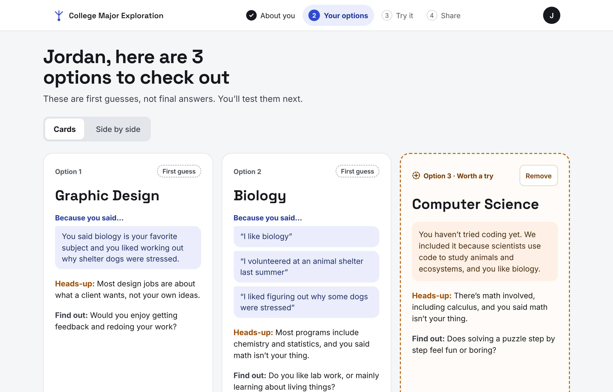
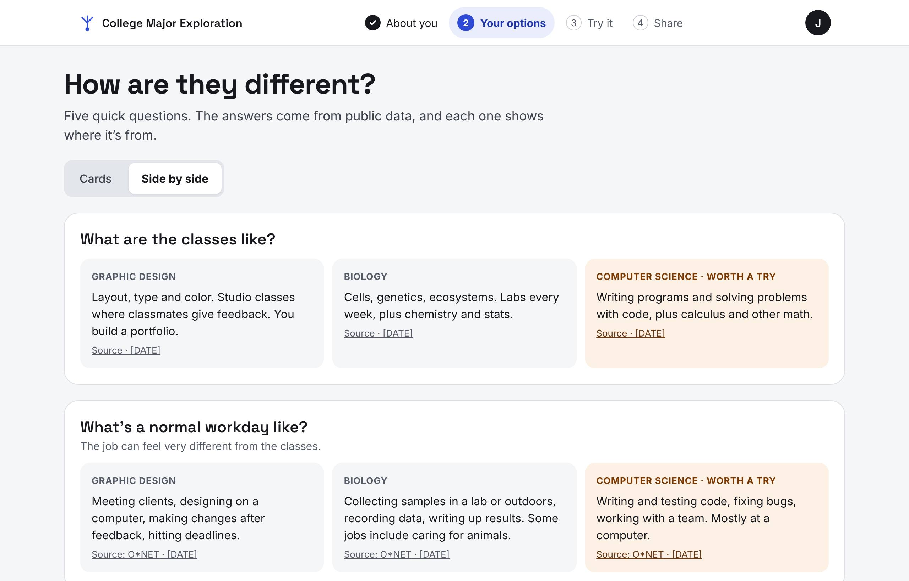
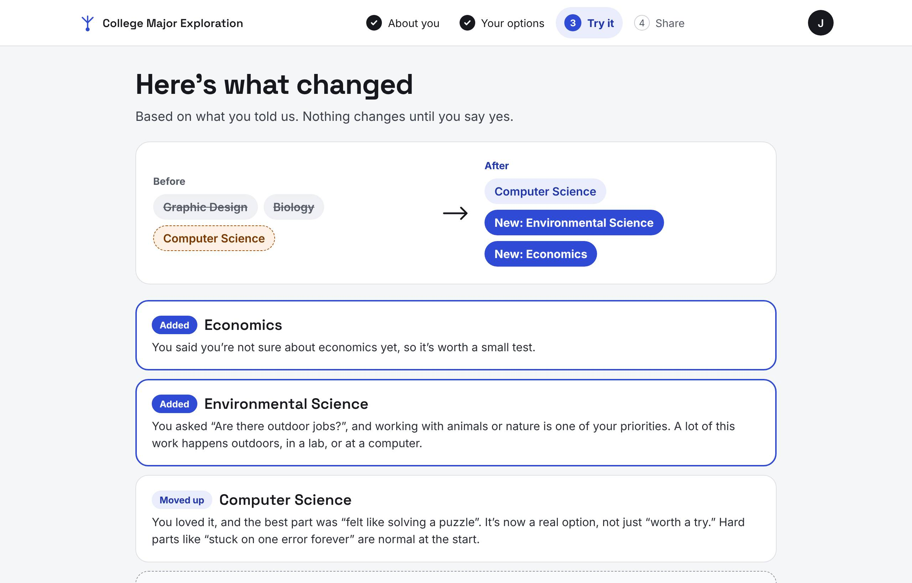
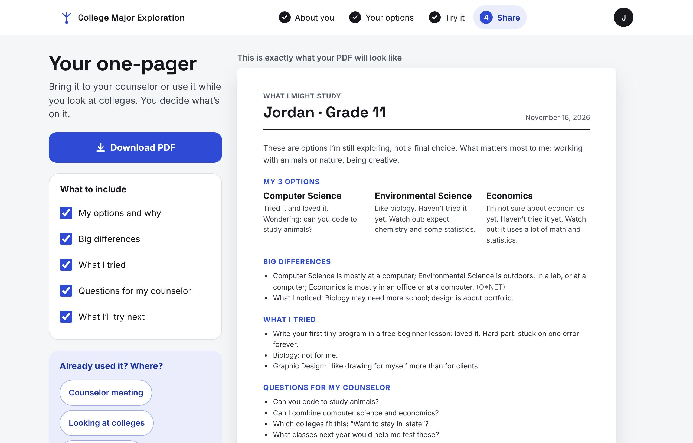

# College Major Exploration

**Try it:** https://ssurwade.github.io/major-explore/ (no install or account needed; your answers stay in your own browser)



| Compare side by side | What changed after trying things | One-pager |
| --- | --- | --- |
|  |  |  |

A web app that helps high-school students explore college majors: a guided intake, an explainable shortlist,
a side-by-side comparison, small real-world activities, reflection, a revised shortlist and a printable one-pager.
It also has a hidden reviewer console (`#reviewer`) where a person can check and edit the generated shortlist text.

## Run it

```sh
npm install
npm run dev        # http://localhost:5173
npm run build      # static build in dist/, works from any folder or static host
```

## How it works

Nothing the student sees is hard-coded. Every screen is generated from what they enter:

- **Intake** (`/intake`) collects name, a reaction to each subject (like / not for me / haven’t tried / not sure),
  free text, up to three priorities, constraints and a starting confidence.
- **Engine** (`src/logic/engine.js`) scores majors from those answers, picks two that fit plus one “worth a try”
  from something not yet tried, and phrases every reason by quoting the student’s own words.
- **Reviewer console** (`#reviewer`, staff only: no student screen links to it) lists each generated sentence with what it’s grounded in. Approve, edit or reject;
  guardrails block wording like “strong match” or percentages. Optional for now: students see their options right away, and any edit made here replaces what they see.
- **Reflection** feeds the **revision** (kept / moved up / removed / added, each with a reason), and the **one-pager**
  is assembled from everything above. Download PDF uses the browser’s print dialog.

State is saved in the browser (`localStorage`), so the student and reviewer views share data only in the same browser.
A backend is the next step for real multi-user use.

## Structure

- `src/styles.css`: design tokens (colors, type, radii) and shared classes.
- `src/components/`: the app header and progress steps (`Screen.jsx`), UI pieces (`Button`, `Toggle`, `Pill`, …), icons.
- `src/data/catalog.js`: the reference catalog of subjects, priorities and majors (facts, activities). This is content the
  engine selects from; `[DATE]` and `[KB RANGE]` are still placeholders until the public-data import (O*NET, BLS,
  College Scorecard) is wired up.
- `src/state/store.jsx`: app state and persistence.
- `src/screens/`: one file per route, wired up in `src/App.jsx`.
